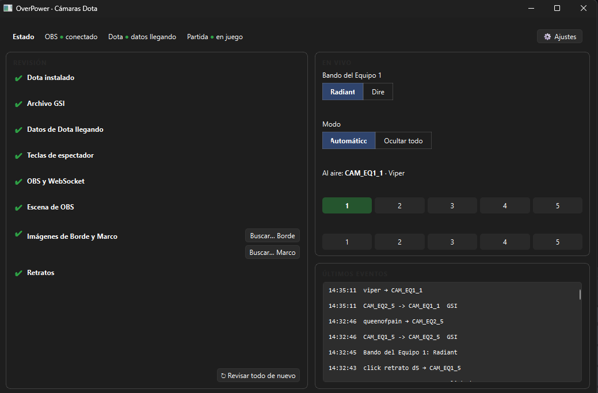
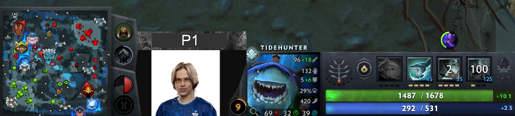

# dota2-obs-playercam

**OverPower Dota Player Cams** (v2 "Camaraman"): a Windows desktop app that automatically
switches player scenes in OBS during Dota 2 broadcasts. The player's scene (camera or photo,
name and border) goes on air instantly on spectator hotkeys and top-bar portrait clicks, and
Game State Integration confirms it. The app also checks your setup and fixes it in one click.
The interface is available in **English and Spanish**.



*Sample player data shown. The interface is also available in Spanish (Settings → Language).*

*In game, the selected player's camera shows up between the minimap and the HUD, with its
border.*



## What it does

While you spectate a match, the app puts on air the OBS scene of the player you have
selected. Each player has a name, a camera link and a photo link (for example, VDO.Ninja
links), and you choose whether the scene shows the camera or the photo:

- **Instantly**, when you press a player's spectator hotkey (read from your Dota settings)
  or click their portrait in the top bar.
- **Confirmed by Dota's Game State Integration (GSI).** GSI also covers clicks on a hero in
  the world, with about 1 s of delay because Dota sends data once per second.
- **Takes the scene off air** when GSI reports no selected hero or when you leave the match.
  Summons and illusions are limited by the data Dota exposes: selecting the Spirit Bear
  can still report Lone Druid as selected, so their HUD cannot yet be distinguished reliably.
- **Fits the HUD:** the scene appears already in place, with the position and scale of the
  Move Source filter that matches the player's number of abilities (4, 5 or 6), and the
  filter's animation plays when that number changes while the player is on air. See
  [The H 4/5/6 filters](#the-h-456-filters).
- **`Borde`:** a fixed border that is visible only while a player scene is on air. It never
  moves or resizes.
- **Innates and upgrades:** counts HUD slots rather than treating every passive innate as
  a separate icon. For example, Treant's Nature's Guise counts as a slot. New Shard/Scepter
  abilities count when Dota reports them in GSI; an upgrade to an existing ability does
  not add a slot. The filter changes while that player is on air.
- **Per-player settings:** name, camera link, photo link and Camera/Photo are applied in OBS
  right away when you edit them (see [Players](#players)).
- **Sides:** you set whether Team 1 is Radiant or Dire, and the app remembers it.

### It checks and fixes your setup for you

When the app opens, each item shows green, yellow or red. When something is missing, the
app **fixes it in one click** (always asking first) or tells you exactly what to do:

| Check | What the app does |
|---|---|
| Dota installed | Finds it in any Steam library, or lets you pick the folder |
| GSI file | Creates Dota's Game State Integration file (and its folder, if missing) or fixes it |
| Data from Dota | Confirms data is arriving; if not, tells you how to enable it |
| Spectator hotkeys | Assigns keys 1–0 to the 10 players and resolves clashes with other actions, only with Dota closed and after making a backup |
| OBS & WebSocket | Checks the connection and password, and guides you if it isn't enabled |
| OBS scene | Checks `Juego`, the 10 player scenes and their 4 sources each, the Move Transition plugin and the 3 H filters; creates missing player scenes by copying `1 Hard carry` |
| Player sources | Warns when a player's selected Camera/Photo source has no URL; updates this check after editing without scanning OBS again |
| Images | Sets the border, mask and background images from the app's image folder (see [Images](#border-mask-and-background-images)) |
| Abilities in GSI | Makes sure the GSI file asks Dota for abilities, so the app knows how many each hero has |

Hotkeys and portrait clicks work from the first use. If you change your Dota hotkeys while
the app is open, it reloads them on its own. If OBS closes mid-broadcast, the app
reconnects when it comes back.

### How it talks to Dota and OBS

```
Dota 2  ──(GSI over local HTTP, ~1/s)──▶  App (127.0.0.1:3000)  ──(OBS WebSocket)──▶  OBS
```

- **Dota → app:** the app writes the GSI config file for you. Dota then posts the match
  state to the app on this PC only.
- **App → OBS:** set up once by you. OBS doesn't let other programs enable its WebSocket
  server or set its password, so you turn it on in OBS and paste the password into the
  app's Settings.

## Requirements

**Nothing to install:** the `.zip` contains everything the app needs (Python, Qt and the
Visual C++ runtime). You only need:

- Windows 10 or 11.
- Dota 2 (Steam).
- OBS Studio **31.1 or later** (required by the bundled Move 3.2.x), with the WebSocket server enabled (Tools → WebSocket Server
  Settings).
- The **Move Transition** plugin by Exeldro for OBS (3.2.1). It is **required**;
  its official installer is included in the demo: see [Install Move Transition](#install-move-transition).
- An OBS scene collection with the structure below. An example is included.

## Installation

1. Download the latest `DotaPlayerCams-vX.Y.Z-windows.zip` from
   [Releases](https://github.com/solqubit/dota2-obs-playercam/releases) and extract the
   **whole** zip.
2. Open `DotaPlayerCams\DotaPlayerCams.exe`.
3. Follow `FIRST_RUN_GUIDE.txt` (or `GUIA_PRIMERA_VEZ.txt` in Spanish). It explains the
   Windows SmartScreen warning (the executable isn't signed) and what to do if your
   antivirus blocks it.

**Language:** the app starts in your Windows language (Spanish if Windows is in Spanish,
English otherwise). Change it in **Settings → Language**; it stays fixed until you change
it again.

Antivirus tools may be suspicious because the app listens to the keyboard and mouse. It only
does so in **Automatic** mode, and it ignores everything that doesn't happen with Dota as
the active window. It doesn't store anything you type, and it only uses the input to detect
spectator hotkeys and clicks.

## Upgrading from v1

v2 uses a different OBS structure (`Juego` plus one scene per player) instead of v1's
`Escena Dota` with `CAM_EQ…` groups, so **v2 does not work with a v1 scene**. Import the
example scene (or migrate your own collection) as described below.

- Your v1 settings are kept: OBS password and port, Dota folder, language, side and learned
  portraits live in `%APPDATA%\OverPowerCamarasDota\` and v2 reads them as they are. The new
  settings (main scene name, team names, player names and links) start empty.
- Extract v2 into a new folder (or replace the old one). v1.0.1 stays available under
  Releases.
- Run the Checks once: the GSI file is updated to also send abilities.

## Install Move Transition

The H 4/5/6 filters need the **Move Transition** plugin by Exeldro. The release includes
the original `Camaraman/Plugins/move-transition-3.2.1-windows-installer.exe`, verified
against the [official release](https://github.com/exeldro/obs-move-transition/releases/tag/3.2.1),
plus its matching source archive and GPL license. Close OBS, run the installer and restart
OBS. Installation is manual. The Checks panel tells you if it or its filters are missing. Without it the app still
switches scenes but cannot resize the scene for 5 or 6 abilities.

## The OBS scene

### Structure (the "Camaraman" collection)

The app works with this exact structure, by name:

- **`Juego`** (the main scene; you can change the name in Settings): the Dota 2 game capture
  (`Captura de juego`), the 10 player scenes as sources, and `Borde`.
- **10 player scenes**, in position order: `1 Hard carry`, `1 Mid laner`, `1 Offlaner`,
  `1 Soft support`, `1 Hard support`, and the same with `2 ` for Team 2. The player in
  position N of Team 1 is `1 <role N>`.
- **4 sources per player scene.** OBS does not allow two sources with the same name in a
  collection, so each scene has its own, named after the scene (the separator is
  space, middle dot, space):

| Source | Type | What it is |
|---|---|---|
| `Camara · <scene>` | Browser | The player's camera link, with a mask filter |
| `Foto · <scene>` | Browser | The player's photo link, with the same mask |
| `Fondo · <scene>` | Image | Background of the name text |
| `Nombre · <scene>` | Text | The player's name |

Only one player scene is on at a time, and inside it only the camera or the photo.
`Borde` is fixed and visible only while a player scene is on air.

### The H 4/5/6 filters

`Juego` has three **Move Source** filters (Move Transition): `H 4 habilidades`,
`H 5 habilidades` and `H 6 habilidades`. Each holds the position and scale the player's scene
should have for that number of abilities (for example, a Dota HUD with a 6th ability needs
the scene smaller). You adjust them in one place, in OBS.

- When a player goes on air, the scene appears already in place: the app reads the position
  and scale from the filters (nothing is hardcoded).
- The app changes the filters' `source` field to the player on air. It never creates
  per-player filters.
- A filter plays its animation only when the player's number of abilities changes while on
  air (for example, with Aghanim's), and with the **Test** button in the OBS scene page.
- With no abilities data the app uses 4; outside 4–6 it uses the nearest.

### Start with the example scene

The release includes a complete **Camaraman** folder: graphics, scene template and plugin
installer. See the [demo guide, including canvas conversion values](docs/DEMO_CAMARAMAN.md).
The template is also at [`obs/example-scene.json`](obs/example-scene.json).
It has `Juego`, the 10 player scenes with their sources, `Borde`, the
3 filters and a game capture of `dota2.exe`, and contains no devices, paths or links from any
PC.

1. Install [Move Transition](#install-move-transition) and restart OBS.
2. Run **`PREPARAR_DEMO.cmd`**, choose the extracted **Camaraman** folder, then import
   the generated **`Camaraman/Ecenas/Camaraman-lista.json`** in OBS: **Scene Collection → Import**.
   The preparer links all graphics locally without changing OBS or the template.
3. **Scene Collection → Camaraman Demo** to switch to it. Your current collection is left
   untouched.
4. Open the app and run **Checks**. The prepared scene already points to the graphics
   inside **Camaraman**. Image **Fix** is available as a fallback. If you move the resource
   folder, run the preparer and import the new generated scene again.
5. Go to **Players** and fill in each player's name and camera/photo links. They are applied
   in OBS right away.
6. **Layout:** the 10 player scenes sit in the same spot of `Juego`, since only one is shown
   at a time. Adjust the H filters to match your canvas (the example is built on
   **3840×2160**, the base canvas). Output can be 1080p or QHD without changing presets.
   QHD output (2560×1440) is separate from the base canvas. See the [exact values and
   conversion factors](docs/DEMO_CAMARAMAN.md#lienzo-base-salida-y-parámetros-de-transformación).

If you already have a collection with `Juego` (or want to build it on another PC), the
**OBS scene** page can create the 10 player scenes by copying `1 Hard carry`, live over
WebSocket and after asking you first.

### Players

The **Players** page lists both teams with their 5 positions. For each player:

| Field | What it does |
|---|---|
| Name | Text of `Nombre · <scene>` |
| Camera / Photo link | URL of `Camara · <scene>` / `Foto · <scene>` |
| Camera / Photo | What the scene shows. If the chosen URL is empty, both media sources stay hidden; the scene transform still applies |
| Abilities | The player's current number of abilities, from GSI |

Changes are saved and applied in OBS immediately; if that player is on air, the change shows
at once. Team names also set the side buttons ("Radiant is …"). Everything is saved in
`%APPDATA%\OverPowerCamarasDota\`.

### Border, mask and background images

The app keeps its images in **`DotaPlayerCams\_internal\assets\`** (in the source tree,
`assets/`):

| File | Used for |
|---|---|
| `Borde.png` | The fixed border (`Borde`) |
| `Mascara camara.png` | Mask of every `Camara · …` and `Foto · …` |
| `Marco sin camara.png` | Background of every `Fondo · …` |

Click **Fix** in **Checks** and the app applies them to OBS live, without closing anything.
You can also use the **Browse…** buttons or pick any image on your PC.

> Installing a new version replaces that folder. Keep a copy of any image you changed and put
> it back afterwards.

## Development

Tested with Python 3.14.

```bash
python -m venv .venv
```
```bash
.venv\Scripts\python -m pip install -r requirements.txt
```

Run the app:
```bash
.venv\Scripts\python -m overpower_cams.app
```

Console version (no window, same settings as the app):
```bash
.venv\Scripts\python console.py
```

Tests (they never touch your real Steam, Dota or OBS):
```bash
.venv\Scripts\python -m pytest
```

### Project layout

| Path | Contents |
|---|---|
| `overpower_cams/engine.py` | Engine: selected hero → camera (confirmed by GSI) |
| `overpower_cams/obs_link.py` | OBS connection, player scenes, H filters, reconnection |
| `overpower_cams/gsi_server.py` | HTTP server that receives Dota's data |
| `overpower_cams/local_input.py` | Hotkeys and clicks while Dota is active |
| `overpower_cams/portraits.py` | Positions of the top-bar portraits |
| `overpower_cams/dota_keys.py`, `gsi_cfg.py` | Spectator hotkeys and the GSI file |
| `overpower_cams/checks.py` | Checks and fixes |
| `overpower_cams/players.py`, `scene_builder.py` | Per-player settings; creating the player scenes |
| `overpower_cams/abilities.py` | Counts the abilities that take a HUD slot |
| `overpower_cams/i18n.py` | Translations (English / Spanish) |
| `overpower_cams/gui/` | Window (PySide6) |
| `console.py` | Console version |
| `assets/` | App images (border, mask, background); in the .exe they live in `_internal\assets\` |
| `obs/example-scene.json` | Example OBS collection (Camaraman v2), ready to import |
| `tools/` | Maintenance scripts (collection migration, innate-ability data) |
| `packaging/` | PyInstaller build, zip script and first-run guides |
| `docs/gamestate_integration_obs.cfg` | Example of the GSI file the app creates |

Per-PC data (settings, language, side, learned portraits, backups and `error.log`) is
stored in `%APPDATA%\OverPowerCamarasDota\`.

After a Dota patch, refresh the bundled innate HUD metadata for all heroes with:

```bash
.venv\Scripts\python tools/update_innates.py --refresh
```

This reads Valve's `herolist`/`herodata` data feeds and distinguishes separate innate
icons, hidden innates, and innates forced into a normal HUD slot. The app itself uses
the bundled snapshot offline. GSI does not expose the full UI behavior flags, so future
patches can require refreshing this snapshot. Automated upgrade tests simulate GSI;
live verification still requires observing the hero's HUD before and after the upgrade.

### Build

```bash
.venv\Scripts\pyinstaller packaging/overpower_cams.spec --noconfirm
```
```bash
.venv\Scripts\python packaging/make_zip.py 2.0.1
```

This creates two git-ignored folders:
- `dist\` with the results: `dist\DotaPlayerCams\` (the app, ready to run) and
  `dist\DotaPlayerCams-v2.0.1-windows.zip`. The zip contains the app, both first-run guides,
  the licenses, third-party notices and the complete Camaraman demo (graphics, scene,
  preparer and Move Transition 3.2.1 installer plus its source).
- `build\` with PyInstaller's temporary files, safe to delete.

### Releasing

See [`packaging/RELEASING.md`](packaging/RELEASING.md). In short:
1. Bump the version and build.
2. Run the zip through VirusTotal.
3. Create a GitHub release with tag `vX.Y.Z` and attach the zip.

## License

[GPL-3.0](LICENSE). Bundled libraries and their licenses are listed in
[THIRD_PARTY_NOTICES.md](THIRD_PARTY_NOTICES.md).

Dota 2 is a trademark of Valve Corporation. OBS Studio is a project of the OBS Project. This
project is not affiliated with or endorsed by either.
