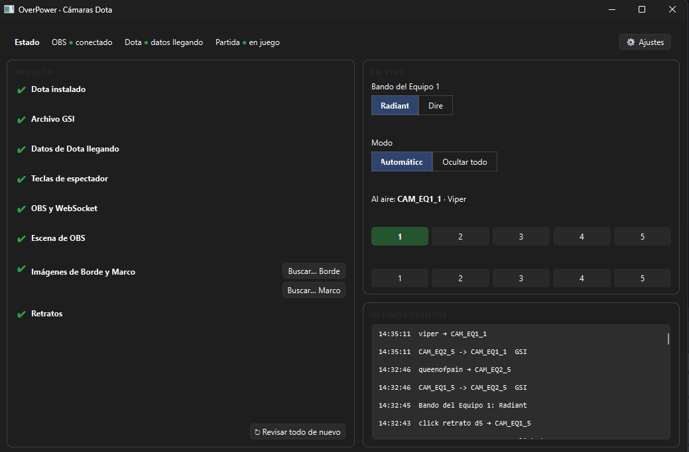
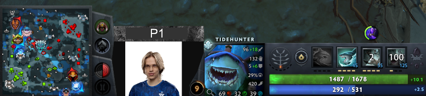

# OverPower Dota Player Cams

Muestra en OBS la cámara o foto del jugador que observas en Dota 2, junto con su nombre y marco. La app cambia de jugador automáticamente para que puedas concentrarte en la transmisión.

**[Descargar última versión](https://github.com/solqubit/dota2-obs-playercam/releases/latest)** · [Guía de la demo](docs/DEMO_CAMARAMAN.md)



*Disponible en español e inglés. La captura muestra datos de ejemplo.*

## Qué puedes hacer

- **Cambiar de cámara automáticamente** al seleccionar jugadores con las teclas de espectador o los retratos de Dota.
- **Elegir cámara o foto** y configurar el nombre de cada jugador, con enlaces como los de VDO.Ninja.
- **Mostrar u ocultar jugadores** y asignar qué equipo ocupa Radiant o Dire.
- **Ajustar la escena al HUD** de 4, 5 o 6 habilidades, incluidos los cambios por Shard o Cetro cuando Dota los informa.
- **Revisar y reparar la configuración:** conexión con Dota, teclas de espectador y rutas de imágenes. La app te pide confirmación antes de repararlas.
- **Configurar una tecla para la cámara asistida de Dota**, de forma opcional y comprobando que esté libre.



## Qué necesitas

- Windows 10 u 11 y Dota 2 en Steam.
- **OBS Studio 31.1 o posterior**, con su servidor WebSocket habilitado.
- **Move Transition 3.2.1** para OBS. Su instalador viene incluido en la demo.

No necesitas instalar Python. El ZIP incluye la app y la **demo Camaraman**, con escenas, gráficos y el plugin.

## Cómo empezar

1. Descarga el ZIP de la [última versión](https://github.com/solqubit/dota2-obs-playercam/releases/latest) y **extrae todo**. Mantén juntas las carpetas `DotaPlayerCams` y `Camaraman`, junto a `PREPARAR_DEMO.cmd`.
2. Con OBS cerrado, instala Move Transition desde `Camaraman/Plugins` y vuelve a abrir OBS.
3. Ejecuta **`PREPARAR_DEMO.cmd`** y selecciona la carpeta **Camaraman** extraída.
4. En OBS, entra en **Colección de escenas → Importar**, importa `Camaraman/Ecenas/Camaraman-lista.json` y selecciona **Camaraman Demo**.
5. Activa el servidor WebSocket en **Herramientas → Ajustes del servidor WebSocket**. Abre `DotaPlayerCams/DotaPlayerCams.exe` y copia el puerto y la contraseña en **Ajustes**.
6. En **Revisión**, comprueba la configuración y usa **Arreglar** donde haga falta. Para reparar las teclas, cierra Dota primero.
7. Completa los nombres y enlaces en **Jugadores**, elige el equipo Radiant y abre una partida en modo observador o una repetición.

La demo usa un **lienzo base de 3840×2160**. Puedes emitir a 1080p o QHD cambiando solo la salida de OBS. La [guía de la demo](docs/DEMO_CAMARAMAN.md) explica los valores y cómo adaptarlos.

## Para tener en cuenta

- Si la URL elegida está vacía, no se muestra cámara ni foto. Desmarca **Mostrar** para ocultar también el nombre, el marco y el borde de ese jugador.
- Las invocaciones e ilusiones no siempre se distinguen del héroe en los datos de Dota; su ajuste de HUD tiene esa limitación.
- Tus ajustes y jugadores se conservan al actualizar. Se guardan en `%APPDATA%\OverPowerCamarasDota`.

Si es tu primera instalación, tienes más ayuda en la [guía de primera vez](packaging/GUIA_PRIMERA_VEZ.txt). Si vienes de v1, importa la colección Camaraman: las escenas antiguas no son compatibles con v2.

<details>
<summary>Desarrollo y pruebas</summary>

Probado con Python 3.14. Desde la carpeta del proyecto:

```powershell
python -m venv .venv
.venv\Scripts\python -m pip install -r requirements.txt
.venv\Scripts\python -m overpower_cams.app
```

Ejecuta las pruebas con `.venv\Scripts\python -m pytest`. No modifican tu instalación real de Dota ni OBS.

Para compilar y empaquetar, consulta [la guía de publicación](packaging/RELEASING.md).

</details>

## Licencia

[GPL-3.0](LICENSE). Consulta las [licencias de terceros](THIRD_PARTY_NOTICES.md).

Proyecto independiente, sin afiliación con Valve ni OBS Project.
